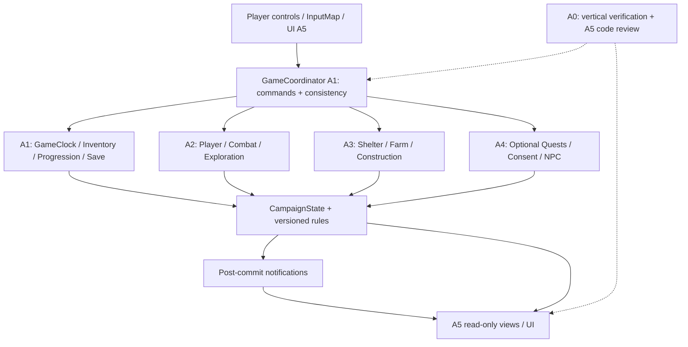

# 06 — Архитектура приложения My Shelter (sandbox-first)

**Статус:** G0 CANDIDATE · 2026-11-05 · **Игровой код ещё не существует.** Область: закрытый 15–35-минутный вертикальный срез + продолжение в режиме песочницы. Входы: [03 требования](03-requirements.md), [05 единственный контракт](05-integration-contracts.md), [09 игровой цикл](09-sandbox-gameplay-design.md).

## 1. Выбор архитектуры

**Модульный монолит Godot 4.7.2-stable + GDScript, 2D top-down.** Версия подтверждена официальной публикацией Godot, но **не проверена в редакторе/на Windows проекта**; реальный запуск выполняет A1 на G1a. Не использовать отдельные серверы, БД, event sourcing, сетевые сервисы или LLM runtime. Сохранение в локальные JSON/DTO.



**Единственный источник истины** — сериализуемые доменные состояния, а не Godot scene nodes и UI. Нет глобального `QuestManager`, который обязан решать, разрешено ли заниматься фермой или исследовать доступную локацию. **Capabilities** определяют реальный доступ; Q03–Q07 лишь наблюдают/подсказывают.

## 2. Конкретная схема модуля

| Контекст | Authoritative state | Владелец |
|---|---|---|
| GameSession/Coordinator/Clock/Save/Inventory/XP | campaign metadata, command receipts, world time, money, item containers, progress | A1 |
| Player/Combat/Exploration | player health/position, active and defeated enemies, exploration flags | A2 |
| Farm/Shelter | plots, crops/deadlines, structures, shelter placement | A3 |
| Quest/Residents/Dialogue | quests, NPC consent, residents, optional story progress | A4 |
| View/UI/UX/E2E | focus/open panels, HUD, snapshots, UI tests; **no authoritative game state** | **A5 — owner ALL UI** |
| Audit/Advisory | findings/evidence/ADR; no domain writes | A0 |

**Никто не правит соседний доменный каталог без согласования.** A1 — технический владелец корня и ядра, A5 — главный по интеграции и координации всей команды. A0 — независимый reviewer и поддержка A5; не отдельный QA-ворот и не интегратор с merge-полномочиями.

## 3. Структура будущего репозитория

```text
project.godot                         # A1
game/
  app/                                 # A1: GameCoordinator/composition root
  autoload/                            # A1: few shared entry points
  contracts/                           # A1: DTO, command/results, events
  state/                               # A1: CampaignState and receipt journal
  scenes/
    main/                              # A1: WorldHost, bootstrap
    hospital/ paris/                   # A2: reusable world scenes
    shelter/                           # A3: farm world scene
    louvre/                            # A4: small contact area
    ui/                                # A5: ONLY UI scenes, reusable UILayer
  systems/
    inventory/ progression/ core/      # A1
    combat/                            # A2
    farming/ building/ economy_shelter/ # A3
    quests/ residents/ dialogue/       # A4
  entities/player/ enemies/            # A2
  ui/ viewmodels/                      # A5
  data/
    rules/ items/                      # A1
    enemies/ loot/                     # A2
    crops/ buildings/                  # A3
    quests/ dialogue/ residents/       # A4
  assets/                              # A5, sources and licenses
  tests/ core/ combat/ shelter/ story/ ui/ e2e/
.github/workflows/                     # A1
docs/book-01/                          # joint PR review
```

All paths are **planned**. `game/scenes/main/Main.tscn` provides persistent `WorldHost` and `UILayer`: A1 instantiates the scene component prepared by A5, does not duplicate UI; scene transitions replace only world child scene. PlayerState outside scenes. One active player per world scene, no duplicate Player nodes after transition.

## 4. State + idempotent transitions

CampaignState (minimum): `schema_version`, `ruleset_version`, `state_revision`, `game_time_minutes`, `scene_id`, `return_position`, `player`, `shelter`, `inventory`, `wallet`, `crops`, `residents`, `quests`, `story_flags`, `completed_actions`, `world_states`.

`item_type_id` vs `item_instance_id`; `resident_id` vs display name. Параметры `grow_minutes`, `spoil_minutes`, `arrival_food_requirement` и `minutes_per_real_second` — in versioned `game_balance`. **Не hardcode две картофелины и 72/12 как универсальные часы.** Один `GameClock` на целых минутах, безопасное ожидание/естественный ход/QA advance пользуются общей моделью времени.

Операция, затрагивающая несколько контекстов, подготавливает план без побочных эффектов, затем коммитит вместе с квитанцией. Только после этого EventBus сообщает о результате. Внешний UI не исправляет счетчики самостоятельно. Подробнее — [05](05-integration-contracts.md).

## 5. Приоритеты и независимость песочницы

P0: первая малая городская зона, один полноценный обычный заражённый, доступные вылазки/лут, убежище, поле, время/отдых, склад, добровольные первые жители, короткие необязательные сюжетные задания, UI A5 и восстановление кампании. **После Q01/Q02** игрок может свободно делать хозяйственные операции и вылазки, даже если не выполнял Q03–Q07.

P1: дополнительные районы, полноценный Лувр/бартер, строительство, работа жителей, оборона. P2: расширенные сценарные арки/лут, если утверждены позже. **Осколок LATER — полностью вне текущей кампании**, нет обязательной зависимости, нет сцен или квестов в G5.

## 6. Технический риск и средства контроля

- **A5 как узкое место:** сначала mock UI shell и API contract; делать доменную логику A1–A4 параллельно, UI-полировку отложить. A0 независимо проверяет P0 UI коды/интеграцию, но не требует своей подписи на каждой декоративной правке.
- **A1 как узкое место:** G1a только минимальные stub APIs и компоновка; остальная реализация в отдельных PR. Другие агенты не блокируются отсутствием всех сервисов.
- **Save/time/food:** тесты на repeated action, corrupted save, deadlines, configurable food, Q03–Q07 inactive. Сохранённое состояние не привязывать к дереву сцен.
- **UI:** read-only ViewModels + командный фасад, focus/pause, unsubscribe/refresh on reload; нет прямого изменения XP, валюты, квестов.
- **Права/контент:** личный закрытый прототип, не размещать чужие полные тексты/ассеты, редакторская политика из 02.

## 7. Процесс G0 → G4

G0 утверждает **документы и владельцев**, G1a доказывает actual Godot GUI/headless+export toolchain, G1b собирает доменные и UI сцены, G2/G3/G4 проверяет E2E. Документ нельзя пометить `IMPLEMENTED` до существования и успешного запуска конкретного `project.godot`. A0 консультирует A5 и сверяет сквозные пути; финальное утверждение G0 — только владельцем проекта.
