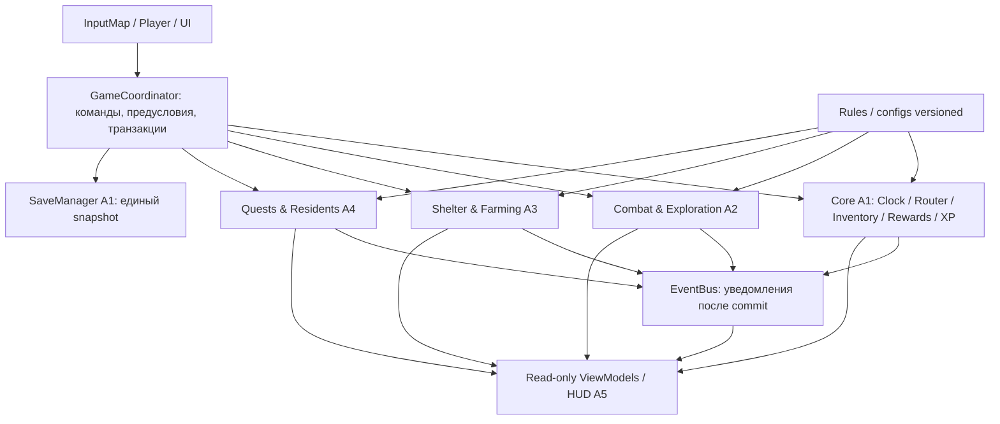

# 06 — Архитектура приложения My Shelter (Book 01)

**Статус:** PROPOSAL / G0 BLOCKED · **Дата:** 2026-11-05 · **Область:** MVP первой книги · **Никакого игрового кода этим документом не создано.**

## 0. Нормативная база и границы
- Требования: [03-requirements.md](03-requirements.md); механики: [01-mechanics.md](01-mechanics.md); сюжет: [02-story.md](02-story.md).
- Командная организация: [04-five-agent-workplan.md](04-five-agent-workplan.md); существующий [05-integration-contracts.md](05-integration-contracts.md) пока DRAFT.
- Ветка [PR #2](https://github.com/AndreyCokol/My_shelter/pull/2) содержит *непринятую* более строгую редакцию (картофель для переселения, ожидание урожая, один зомби в P0). Этот ADR **предлагает** согласовать её с main; не считает PR #2 смерженным.
- Литературные числа отделяются от игровых допущений: **[К] канон первого тома**, **[П] предлагаемое проектное правило**, **[?] открытый вопрос**. Полный текст книг в игру/репозиторий не копировать.
- Только одиночная офлайн-игра, Godot 4.x, GDScript, Windows x64, top-down pixel-art. Без серверов, облака, мультиплеера, генеративного ИИ во время игры, томов 2–13 и тысяч физических NPC в MVP.

## 1. Архитектурный стиль
**Модульный монолит с data-driven доменом, явными командами и событиями уведомления (НЕ event sourcing).** Godot — runtime/представление; логика ресурсов, времени, XP, квестов должна быть проверяема без живой 2D-сцены. Никаких микросервисов и внешних БД.



**Единственный путь записи:** UI/игровой объект → публичная команда владельца → проверка/атомарный commit → события → обновление view. Слушатели событий не делают повторную выдачу наград. Для сквозных действий (переселение + списание еды; сбор урожая + добавление в инвентарь) координацию транзакции ведёт A1; предметные проверки остаются у A3/A4. Подписка на EventBus не заменяет команду.

## 2. Модули, владение данными и зависимости

| Контекст | Хранит и изменяет | Читает/вызывает | Владелец |
|---|---|---|---|
| Session / Coordinator | CampaignMeta, реестр результатов операций, правила commit, жизненный цикл | Все доменные API | A1 |
| GameClock | `game_time_minutes`, пауза, скорость, безопасное ожидание | A3, A4 — только чтение/уведомления | A1 |
| Progression / Economy / Inventory | PlayerXP, ShelterXP, discovered item types, монеты, контейнеры, предметы, посылки, пищевые резервы | A2–A4 через команды, A5 через snapshots | A1 |
| SceneRouter | `scene_id`, наружная точка возврата, точки появления | A2/A3/A4 по запросу | A1 |
| Exploration / Combat | здоровье/позиция героя, активные враги/боевые статусы, факты побед | A1 инвентарь и вознаграждения | A2 |
| Shelter / Farm | карта убежища, поле, стадии, время созревания/порчи, здания | A1 часы + Inventory, A4 косвенно | A3 |
| Narrative / NPC / Quest | флаги сценария, согласия, уникальные жители, progress квестов | A1 inventory/progression/clock | A4 |
| UI / Visual / QA | UI state (открытая вкладка, фокус), графика, E2E-сценарии; НЕТ авторитетных игровых данных | snapshots, команды, уведомления | A5 |

**Разделять state и scene:** сериализуемые состояния (чистые DTO/Dictionary/Resource в памяти) не содержат NodePath, ссылки на сцену, Texture2D, Callable, Signal или Timer. На карте сцены — проекции состояния. Уничтожение сцены **не** удаляет кампанию.

**Правило зависимостей:** A2/A3/A4 не импортируют конкретные классы друг друга и не пишут чужие файлы. Только A1 фасад, публичные DTO/команды и events. A5 не обходит фасад прямым присваиванием.

## 3. Структура будущего репозитория (НЕ создавать код до G0)

```text
project.godot                      # A1; один владелец
game/
  app/                             # A1: GameCoordinator + composition root
  autoload/                        # A1: GameSession, EventBus, GameClock, SaveManager, RulesRegistry
  contracts/                       # A1: DTO, codes, events, interface registry; менять через ADR
  state/                           # A1: persisted CampaignState, common ID and journal schema
  systems/
    inventory/ progression/ economy_core/ scene_router/    # A1
    combat/                                                  # A2
    farming/ building/ economy_shelter/                       # A3
    quests/ residents/ dialogue/                             # A4
  entities/player/ entities/enemies/                          # A2
  scenes/
    main/                                                    # A1 root/bootstrap
    hospital/ paris/                                         # A2
    shelter/                                                 # A3
    louvre/                                                  # A4
    ui/                                                      # A5
  ui/ viewmodels/                                            # A5; только read-only projection
  data/
    rules/ items/ skills/                                    # A1 registry, владельцы коллекций по ADR
    enemies/ loot/                                           # A2
    crops/ buildings/                                        # A3
    residents/ quests/ dialogue/                             # A4
  assets/                                                    # A5 лицензии и индекс
  tests/
    core/ integration/                                       # A1
    combat/                                                 # A2
    shelter/                                                # A3
    story/                                                  # A4
    ui/ e2e/                                                # A5
.github/workflows/                                            # A1
docs/book-01/                                                # согласование через review
```

Примечание: старый план указывает `game/scenes/louvre/**`, `game/scenes/hospital/**` и т.д.; сохранить эти имена, согласовав неоднозначные `paris_streets` vs `paris` **один раз на G0**, не создавать два дерева. Все пути из этого раздела — только *proposal*; окончательный список должен заменить расхождения в 03/04/05.

**Godot сцены:** `Main.tscn` содержит постоянный `WorldHost` и `UILayer`. `SceneRouter` заменяет вложенную world-сцену (hospital ↔ shelter ↔ paris ↔ louvre); HUD A5 не уничтожается при переходах. `Player.tscn` предоставляется A2 как переиспользуемая сцена; один герой на активной world-сцене, authoritative PlayerState хранится вне неё. `WorldHost` и переходы собирает A1.

**Autoload policy:** максимум несколько entry points: `GameSession`, `EventBus`, `GameClock`, `SaveManager`, `RulesRegistry`. Доменные системы — сервисы композиционного корня, а не глобальные writeable autoload на каждый объект. Публичные snapshots возвращают **копии**, не ссылки на изменяемые словари.

## 4. State model (минимальный MVP)
`CampaignState`:
- `schema_version:int`, `ruleset_version:string`, `save_id:string`, `game_time_minutes:int`;
- `current_scene_id:string`, `return_scene_id:string`, `last_outside_position:{x:float,y:float}`;
- `player:{health,level,xp,stats,unlocked_skills,position}`;
- `shelter:{level,xp,discovered_item_type_ids,claimed_parcel_ids,placed_buildings}`;
- `wallet:{system_coins:int}`, `inventory:{items,containers,reservations}`;
- `crops:{plots}`, `residents:{records,accepted_contract_versions}`, `quests:{records}`, `story_flags:[string]`;
- `completed_actions:{action_id -> {payload_fingerprint, result, committed_at_game_minute}}`;
- `world_states:{scene_id -> persistent entities/dropped items}` **только для нужных MVP-сцен**.

`item_type_id` отличается от `item_instance_id`; `quantity` — целое >0, для уникальных объектов 1; позиция/имя не являются ID. Разделены `character_xp` и `shelter_xp`. Разблокировки/значения XP — из `game_balance` конфигов, источник [К] маркируется отдельно.

## 5. Время и игровая логика
- Авторитетное время: **целые игровые минуты** `game_time_minutes` (без drift float). `GameClock.advance(delta_minutes, context)` изменяет только в разрешённой команде.
- Весь рост, порча и таймеры квестов: дедлайны в игровых минутах. Не использовать локальные Godot Timer для игрового времени; Timer допустим только для визуальных анимаций/паузы кадров.
- Режим pause блокирует движение и gameplay clock, но не UI.
- [К] конкретное поле картофеля: 72 игровых часа роста после требуемого полива; 12 часов до порчи на поле; погреб предотвращает порчу собранной еды.
- [П] Ожидание урожая у палатки: UI запрашивает `try_rest_until(target_game_minute)`; координатор валидирует местоположение/состояние и **одним** переходом обновляет clock и все зависимые системы в фиксированном порядке. Отдельный `advance_for_test()` только в QA build.
- [П] Предложение G0: 1 игровая минута = 1 реальная секунда активного gameplay (1 игровой час/60 секунд), но длинное ожидание игрок осуществляет отдыхом в палатке. Это **не утверждённый баланс**, менять после UX-прототипа.
- Устанавливаем порядок расчёта на переходе времени: **clock tentative → рост/порча → сюжетные deadlines → commit → events**; тестировать переход через несколько границ за один `advance` и поведение ровно на 72h/84h.

## 6. Domain сценарии и инварианты

### 6.1. Бой / первое подключение
A2 валидирует попадание, здоровье и поражение зомби; финал победы передаёт A1 как одну команду с `action_id`, `enemy_id`, `weapon_type_id`. A1 гарантирует единственность награды и XP; A4 проверяет квестовые условия по результату commit. Повторный вызов после загрузки — `ALREADY_APPLIED` с тем же результатом, **не повторное начисление**. Стартовый зомби и системное оружие — сценарный gate.

### 6.2. Инвентарь и перенос
Любое перемещение, выдача предметов, покупка, получение посылки, урожай — атомарная команда с балансом до/после и проверкой вместимости. Условия `origin` и допустимости переноса из канона не дополнять правилом «переноси всё». При split stack сумма количеств сохраняется. Не допускаются отрицательные деньги, предметы вне контейнера без world-state или два контейнера с одним instance_id.

### 6.3. Ферма
`EMPTY → TILLED → PLANTED → WATERED/GROWING → RIPE → SPOILED`; в данных хранить реальные предусловия/дедлайны, не восстанавливать их по frame ticks. Неудача выдачи урожая при заполненном инвентаре **не** помечает поле собранным. Собранный урожай в погребе не портится. [П] Приём первых жителей опирается на выращенную еду в отдельном food reservation — см. §6.4.

### 6.4. Первые жители и сюжет
A4 отвечает за сюжетное согласие Алис и Пирра, уникальные `resident_id` и версию правил. [П] после согласия статус `AWAITING_SUPPLIES`, пока не доступно две выращенные картофелины; **один batch commit** резервирует 2 единицы (по 1 на человека), переносит обоих жителей в `RECRUITED`, пишет квитанцию и обновляет квест. Не хватает еды → никакого резерва и ни одного переселения. Повторный `action_id` → тот же результат; другой payload с тем же ID → `ACTION_CONFLICT`. Нет постоянного голода или производства в P0; `job_id` хранится без симуляции.

### 6.5. Будущий масштаб P1
1000 жителей за 7 игровых суток учитывать как aggregate `ResidentGroup` с количеством и уникальными batch IDs, а не спавнить 1000 CharacterBody2D. Полный Лувр, торговля, мутанты, оборона и финальная глава — после G4. Дизайн не должен требовать P1 для запуска P0.

## 7. Связь с UX и игроком
- A5 подписывается на доменные **уведомления** или запрашивает snapshot, не присваивает `GameState`.
- UI должен отображать результат команды: `OK`, `INSUFFICIENT_RESOURCES`, `CAPACITY_EXCEEDED`, `INVALID_STATE`, `REQUIRES_CONSENT`, `ALREADY_APPLIED`, `UNAVAILABLE`.
- Отображать XP героя и убежища раздельно, подтверждение условий контракта, ожидание сна/урожая, недостаточность запасов, save/load errors, вход/выход из убежища.
- Определить доступность InputMap, UI focus, pause modal, масштабирование пикселей, состояние без мыши и разрешения окон на G0.

## 8. Не включать в MVP
Многопользовательские синхронизации, удалённые сервисы и телеметрия, database/ORM, LLM-агенты в игре, сложная физическая погода, экономическая симуляция сотен жителей, procedural unlimited world, всё из томов 2+. Ни одно из этих решений не должно усложнять MVP-интерфейсы «на будущее».

## 9. Как принимать архитектуру
Решения/ADR и контракт [07-contract-spec-proposal.md](07-contract-spec-proposal.md) + [08-g0-decision-record.md](08-g0-decision-record.md) должны получить ревью A1–A5; владелец явно утверждает параметры и commit SHA в [Issue #4](https://github.com/AndreyCokol/My_shelter/issues/4). До этого **G0 = BLOCKED**, а этот документ является проектным предложением, не лицензией начинать кодировать.
